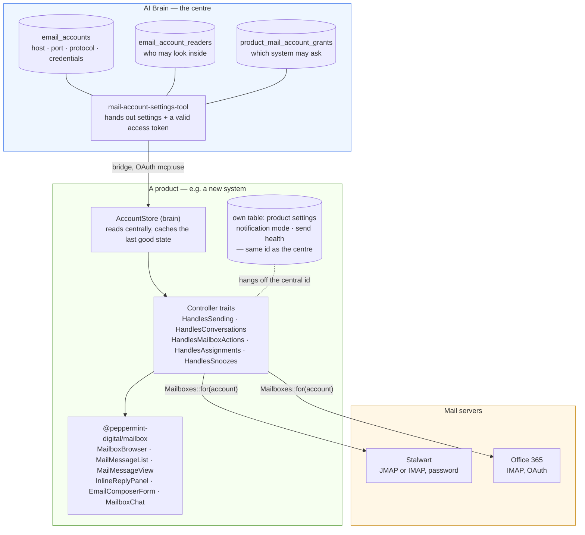

# Attaching a system to the mailbox

What a product has to bring, what it gets, and where the truth lives. Written
on 2026-10-13, when the fourth product moved onto the central store and the
pieces stopped differing between installations.

Read [the README](../README.md) first for what the package is. This file is for
the question **"we have a new system — what do we wire?"**

## The shape



Three sentences that the picture is trying to say:

1. **A mailbox exists once, in AI Brain.** Connection, credentials, owner and
   the read list live there and nowhere else.
2. **A product reads it, never owns it.** `AccountStore` with `store: brain`.
   Whatever the product needs *beyond* the mailbox — notification mode, send
   health, its own assignments — stays in its own table, keyed by **the central
   id**.
3. **Nobody re-implements the browser.** List, folders, message view, reply,
   conversation, address book, bulk actions and the assistant come from this
   package. The product supplies words, an editor, and its own toolbar.

## What a new system wires

### 1. Install

```bash
composer require peppermint/mailbox peppermint/ai-brain-bridge
npm install github:peppermint-digital/mailbox
```

### 2. Point it at the centre

```php
// config/mailbox.php
'store' => env('MAILBOX_STORE', 'brain'),
```

`local` is for an installation that has **no** AI Brain — then the application
keeps its own mailbox rows and maintains them itself. Anything else is a
transitional state, not a target.

Without the bridge the package falls back to `local` **and logs a warning**.
Silently falling back would mean somebody believes the settings are central
while they are local, and edits the wrong copy on the next rotation.

### 3. Get the mailboxes granted

Nothing is handed out without a grant: in AI Brain, `product_mail_account_grants`
decides which mailboxes this system may ask for. Nothing granted means an empty
list — not an error, and not everything.

Granting a **personal** mailbox is safe: the package shows it to its owner only
(matched by address, not by id). Granting a **group** mailbox respects its read
list; no list means everyone.

### 4. Build the controller from traits

```php
class MailboxController extends Controller
{
    use HandlesSending;          // POST {account}/send
    use HandlesConversations;    // the thread behind a message
    use HandlesMailboxActions;   // seen · flagged · move · delete · bulk
    use HandlesAssignments;      // who is working on this message
    use HandlesSnoozes;          // remind me later

    public function __construct(private readonly AccountStore $store) {}
}
```

Route them under `mailbox/{account}/…`. The three existing products use the same
names; copying them means a reader recognises the system.

### 5. Mount the browser

The product supplies three things the package deliberately does not have:

| The product brings | Why not in the package |
|---|---|
| **Words** (German here) | A package that ships sentences ships a language. Code is English, the interface is the product's. |
| **An editor** | One product wants rich text, another a plain field. |
| **Its own toolbar** | "Create a ticket", "take over as a receipt", "assign a task" — that is the product, not the mailbox. |

```tsx
<MailboxBrowser
    folders={<MailFolderList … />}
    list={<MailMessageList … />}
    view={
        antwortOffen
            ? <InlineReplyPanel account={…} message={…} composer={ProductComposer} labels={…} onSend={…} />
            : <MailMessageView … extraActions={<YourToolbar />} />
    }
    aside={<MailboxSidePanel><MailboxChat … /></MailboxSidePanel>}
/>
```

Wrap the package pieces in thin product components (~18 lines each) that inject
labels and the composer. All four products do it that way; see
`peppermint-manager/resources/js/components/inline-reply-panel.tsx`.

### 6. Check it the way the others were checked

- Does the list show the same mailboxes as AI Brain, per person?
- Does a personal mailbox stay invisible to everyone but its owner?
- Does a group mailbox with a read list stay invisible to everyone else?
- Does sending work — **actually send one**, do not stop at the form.
- `emails:check-send` or the product's equivalent: green for every mailbox.

## What is deliberately NOT uniform

- **The editor** (rich text vs. plain).
- **The toolbar** next to a message — each product's own verbs.
- **Forwarding**: still product-side, because it needs an endpoint that re-sends
  the original attachments. That belongs in this package and is the next piece
  of work; until then a product either has its own or sends forwards through its
  compose page.
- **Assignments**: three products use `MailAssignmentPicker` from the package,
  the Manager still has its own. Same feature, two implementations — being
  retired.

## The traps that cost us time

| Trap | What it looks like |
|---|---|
| Identifying a mailbox by **id** across systems | Works by accident when the ids happen to match; delivers the wrong conversation when they do not. Use the **address**. |
| A product copying `is_active` from the centre | "This mailbox stopped fetching" — nobody reads it as a decision. Whether a product uses a mailbox is the product's call. |
| An empty answer treated as an empty truth | A central system that does not answer must leave the local stock untouched. |
| A read list read as "nobody" when empty | Empty means **everyone**. The other reading silently takes mailboxes away on the day the feature ships. |
| Tests that reach the real centre | `MAILBOX_STORE=local` in `phpunit.xml`, and assert the production value by reading the **file**. |
