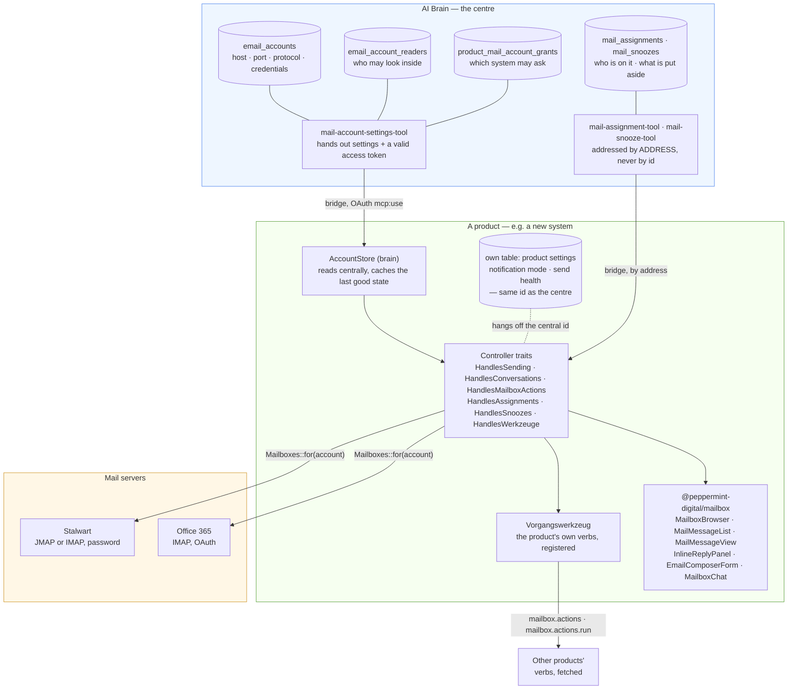

# Attaching a system to the mailbox

What a product has to bring, what it gets, and where the truth lives. Written
on 2026-10-13, when the fourth product moved onto the central store and the
pieces stopped differing between installations.

Read [the README](../README.md) first for what the package is. This file is for
the question **"we have a new system — what do we wire?"**

## The shape



Three sentences that the picture is trying to say:

1. **A mailbox exists once, in AI Brain.** Connection, credentials, owner and
   the read list live there and nowhere else.
2. **A product reads it, never owns it.** `AccountStore` with `store: brain`.
   Whatever the product needs *beyond* the mailbox — notification mode, send
   health, signatures — stays in its own table, keyed by **the central id**.

   **Responsibility and snoozes are not in that list any more** (19.10.2026).
   They describe the *conversation*, not a product's handling of it, so they
   moved to the centre: four tables meant four answers to "who is working on
   this mail". See step 4c for the move.
3. **Nobody re-implements the browser.** List, folders, message view, reply,
   conversation, address book, bulk actions and the assistant come from this
   package — the editor included, and since 19.10.2026 the toolbar too. The
   product supplies words and **registers its verbs**; what the toolbar then
   carries is every verb this person is granted, from every system. See
   [WERKZEUGE.md](WERKZEUGE.md).

## What a new system wires

### 1. Install

```bash
composer require peppermint/mailbox peppermint/ai-brain-bridge
npm install github:peppermint-digital/mailbox
```

### 2. Point it at the centre

```php
// config/mailbox.php
'store' => env('MAILBOX_STORE', 'brain'),
```

`local` is for an installation that has **no** AI Brain — then the application
keeps its own mailbox rows and maintains them itself. Anything else is a
transitional state, not a target.

Without the bridge the package falls back to `local` **and logs a warning**.
Silently falling back would mean somebody believes the settings are central
while they are local, and edits the wrong copy on the next rotation.

### 3. Get the mailboxes granted

Nothing is handed out without a grant: in AI Brain, `product_mail_account_grants`
decides which mailboxes this system may ask for. Nothing granted means an empty
list — not an error, and not everything.

Granting a **personal** mailbox is safe: the package shows it to its owner only
(matched by address, not by id). Granting a **group** mailbox respects its read
list; no list means everyone.

### 4. Build the controller from traits

```php
class MailboxController extends Controller
{
    use HandlesSending;          // POST {account}/send + {account}/forward
    use HandlesConversations;    // the thread behind a message
    use HandlesMailboxActions;   // seen · flagged · move · delete · bulk
    use HandlesAssignments;      // who is working on this message
    use HandlesSnoozes;          // remind me later
    use HandlesWerkzeuge;        // the product's verbs, merged across systems

    public function __construct(private readonly AccountStore $store) {}
}
```

Route them under `mailbox/{account}/…`. The three existing products use the same
names; copying them means a reader recognises the system.

**Forwarding** comes with `HandlesSending` as a second route, and it is the one
place where a product may need to say something. The payload carries
`source_type`:

| `source_type` | Who fetches the original attachments |
|---|---|
| `imap` | the package, via `Mailboxes::for($account)` — and that covers JMAP accounts too; the word means "from the mail server", not "over IMAP" |
| anything else | the product, by overriding `originalAttachments()` — a product with its own archive knows where the bytes are, the package does not |

If the attachments cannot be fetched, the endpoint answers **502 and sends
nothing**. The alternative — forwarding the text without the invoice it is
about — looks like success to the sender and is noticed by the recipient.

### 4b. Hand `assignableUsers()` an address

`HandlesAssignments` asks the product who may be assigned. Since 19.10.2026
that list must carry `email`:

```php
protected function assignableUsers(int $account): array
{
    return User::query()->orderBy('name')->get(['id', 'name', 'email'])->map(...)->all();
}
```

Not cosmetic. Responsibility lives in the centre now, and **a user id is not
the same person across systems** — every product keeps its own `users` table,
so user 5 here is somebody else there. A number written centrally points at the
wrong person in the next system, and that shows up only as a wrong name on a
badge.

A person without an address cannot be assigned. The endpoint refuses with a
sentence rather than quietly storing nothing.

### 4c. Move the existing state before you switch

`store: brain` means responsibility and snoozes are read **from the centre**.
The moment the package is updated, the product's own rows are unreachable — not
deleted, just invisible. And that does not look like a fault: every mail
appears free, nobody is responsible any more, and anything put aside is back.

So, before switching, run:

```bash
php artisan mailbox:zustand-umziehen              # dry run, writes nothing
php artisan mailbox:zustand-umziehen --ausfuehren
```

The dry run prints the **real** inventory with the column nobody writes down:
*is this person known centrally?* A person without an address does not move and
the run **fails** — on purpose. A partial move that reports success gets a green
tick in a deploy chain, and the missing responsibility is noticed by the person
whose work disappeared.

Local rows are kept. They are the way back if the move was incomplete; clearing
them up is a separate, later step.

### 5. Mount the browser

The product supplies two things the package deliberately does not have:

| The product brings | Why not in the package |
|---|---|
| **Words** — or rather, the ones that differ | The package ships German **defaults** (`germanLabels`); a product spreads and overrides what it says differently. Measured on 19.10.2026: the six label blocks were word-for-word identical in all four products, ~500 lines in total, and only 6 of 112 keys differed. A better phrasing in one copy reached none of the others. The old rule — "a package that ships sentences ships a language" — still holds, which is why these are defaults and not fixtures: pass your own object and the package imposes nothing. |
| **Its verbs** — registered, not drawn | "Create a ticket", "take over as a receipt", "assign a task" — what they *mean* is the product. Where they *appear* is not: they are registered as `Vorgangswerkzeug` and the package assembles one toolbar from all systems. [WERKZEUGE.md](WERKZEUGE.md) |

The **toolbar** left that list on 19.10.2026, for the same reason the editor
did: three different toolbars meant a user re-learned the same mail in every
window, and a verb was reachable only from the product that happened to own the
window. The verbs stayed the product's; the surface did not.

The **editor** used to be on that list. It is not any more (14.10.2026): bold is
bold in all four products, and a reply that looked different depending on which
window you opened was a defect, not a liberty. Pass `RichTextEditor`; where a
product can do something extra *with* the text — an assistant that rephrases,
dictation — hang it in `extraActions` and its feedback in `statusBar`.

Tiptap is a **peer** dependency. A product that already uses Tiptap would
otherwise end up with two copies, and TypeScript rejects one copy's extensions
for the other copy's editor even though the types are identical. Keep the whole
`@tiptap/*` family on one version — they pin their siblings exactly, so a mixed
set fails to install at all.

```tsx
<MailboxBrowser
    folders={<MailFolderList … />}
    list={<MailMessageList … />}
    view={
        antwortOffen
            ? <InlineReplyPanel account={…} message={…} composer={ProductComposer} labels={…} onSend={…} />
            : <MailMessageView … extraActions={<YourToolbar />} />
    }
    aside={<MailboxSidePanel><MailboxChat … /></MailboxSidePanel>}
/>
```

Wrap the package pieces in thin product components (~18 lines each) that inject
labels and the composer. All four products do it that way; see
`peppermint-manager/resources/js/components/inline-reply-panel.tsx`.

### 6. Check it the way the others were checked

- Does the list show the same mailboxes as AI Brain, per person?
- Does a personal mailbox stay invisible to everyone but its owner?
- Does a group mailbox with a read list stay invisible to everyone else?
- Does sending work — **actually send one**, do not stop at the form.
- `emails:check-send` or the product's equivalent: green for every mailbox.

## What is deliberately NOT uniform

- ~~**The toolbar** next to a message — each product's own verbs.~~ Overtaken on
  19.10.2026. The verbs are still each product's; the toolbar is one, and it
  carries what this person is granted across all systems. The *meaning* of a
  verb stays where it belongs, its *reachability* no longer depends on which
  window you opened. See [WERKZEUGE.md](WERKZEUGE.md).
- **How assignments are *picked***: three products use `MailAssignmentPicker`
  from the package — a badge with a dropdown. The Manager assigns by
  right-clicking a row. The *backend* is shared (`HandlesAssignments`, same
  columns, the Manager just points `mailbox.tables.assignments` at its existing
  table), so this is a difference in interaction, not in data. Changing it
  changes a daily habit; that is a decision, not a cleanup.

## The traps that cost us time

| Trap | What it looks like |
|---|---|
| Identifying a mailbox by **id** across systems | Works by accident when the ids happen to match; delivers the wrong conversation when they do not. Use the **address**. |
| A product copying `is_active` from the centre | "This mailbox stopped fetching" — nobody reads it as a decision. Whether a product uses a mailbox is the product's call. |
| An empty answer treated as an empty truth | A central system that does not answer must leave the local stock untouched. |
| A read list read as "nobody" when empty | Empty means **everyone**. The other reading silently takes mailboxes away on the day the feature ships. |
| Tests that reach the real centre | `MAILBOX_STORE=local` in `phpunit.xml`, and assert the production value by reading the **file**. |
